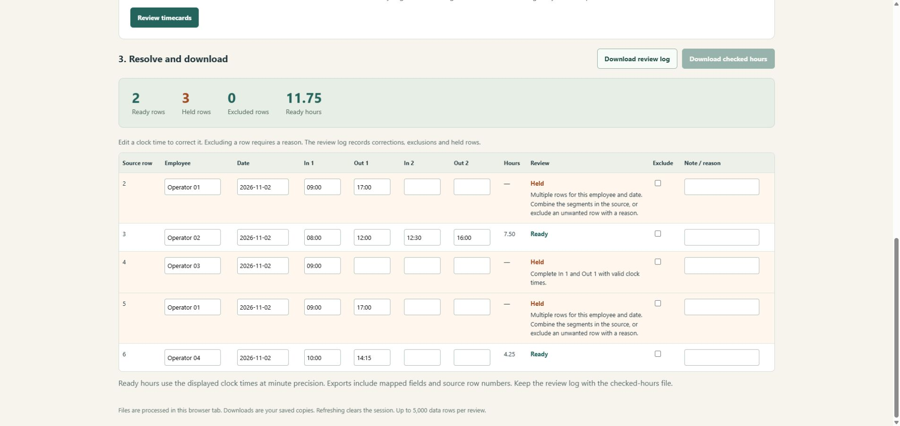
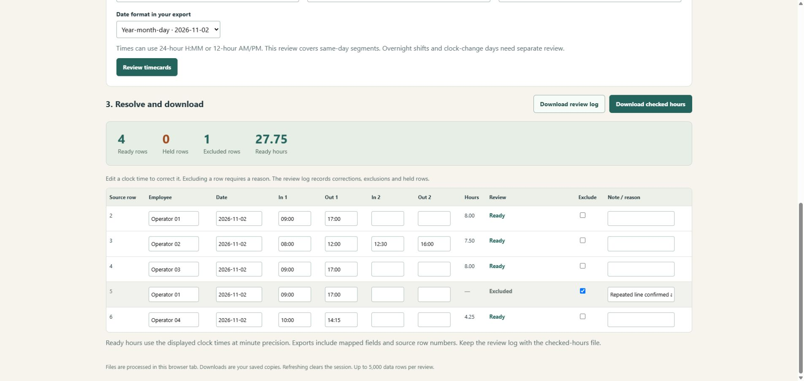

# Shift Sheet

Check a team’s timecard CSV before passing the hours along. Missing punches and repeated employee/day rows stay visible until you correct them or record an exclusion reason.

[Open Shift Sheet](https://srworkbench.github.io/shift-sheet/)

## Try it in a minute

1. Open the page and choose **Load example**, or import a UTF-8 CSV.
2. Check the column choices and date format, then choose **Review timecards**.
3. In the example, fill row 4’s missing **Out 1** with **17:00**. Add a reason to row 5 and select **Exclude** after confirming the repeated line.
4. Download **checked hours** and the **review log**. The example produces four checked rows, one exclusion and **27.75 hours**.

## Your CSV

Keep a header row and one employee/date per data row. Map Employee, Date, In 1 and Out 1. A second In/Out pair is optional. Example:

    Employee,Date,In,Out,In2,Out2
    Operator 01,2026-11-02,09:00,17:00,,
    Operator 02,2026-11-02,08:00,12:00,12:30,16:00

Choose year-month-day, month/day/year or day/month/year explicitly. Valid dates span 1900–2199. Clock times accept H:MM, H:MM:00, or English AM/PM. A zero is midnight. An unused second segment may be blank or zero in both fields.

Use distinct employee IDs when people share names. Employee/day checks ignore case and repeated whitespace. Multiple source rows for the same person/day require review. Combine legitimate segments in the original source, then import again.

The source-row number counts CSV records, including blank records, with the header counted as row 1. A quoted cell containing a line break stays one record.

## What the downloads contain

**Checked hours** includes ready rows with clock times, exact minutes, decimal hours, source-row numbers and any corrections or notes. Every held row must be resolved or explicitly excluded with a reason before this download becomes available.

**Review log** includes all mapped rows, their status, issues, exclusions and corrections. Keep it with the original export and checked-hours file. Other source columns stay in your original file.

Editing the source or column choices starts a fresh review. Downloads are saved copies. Refreshing the page clears the session. Processing happens in the browser tab, with no external scripts or data requests.

## Limits

Up to 5,000 data rows and 2 million characters per review. Each row supports one or two same-day work segments. Nonzero seconds, overnight shifts and clock-change days require separate handling. Minutes are authoritative; the displayed hours round to two decimals and exported hours to four.

This calculates elapsed clock minutes. Pay rates, overtime, break entitlements and other payroll rules belong in the payroll process. Exclusions require the reviewer’s decision. A correct-looking time is still something to confirm against the source.

The example data and screenshots were made for this tool.

## Developer checks

The page uses plain HTML, CSS and JavaScript. It has no package dependencies. Node.js 22 or later runs the checks:

    node --test tests/core.test.cjs
    node demo.cjs NEW_OUTPUT_DIRECTORY

The tests cover CSV quoting, record numbers, incomplete and overlapping segments, date ambiguity, zero-filled optional segments, duplicate employee/day handling and spreadsheet-formula escaping.
